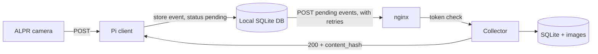

# Mobile Vehicle Counter Pi Client

This is Autonomous Systems Inc.'s project to count vehicles and analyze traffic through a subdivision gate.

This specific project is the server's Pi client. It accepts POSTed data from automatic license plate recognition (ALPR) cameras and relays it to the collector server. Because the collector server is a long distance away over the internet, this Pi client must retry sending data when attempts fail, without losing or duplicating events.

The code of this Pi client is derived from the collector server's, since they share a similar structure and function. As a result, some leftovers from the server project (for example the crate name `mobile_vehicle_counter_server` in `Cargo.toml`) have not been renamed yet.

## Architecture



1. A camera posts a vehicle ALPR event to the Pi.
2. The Pi assigns the event a random `event_id`, builds the final request body **once**, and saves it (the exact bytes) in a local SQLite database with status `pending`.
3. The sender POSTs the saved bytes to the collector, over HTTP to start, but later over HTTPS, through nginx.
4. The Pi updates the event's status in the database: `delivered` once the collector's receipt is verified (it was received and correctly inserted by the collector server), or `failed` if the collector rejects it in a way that retrying cannot fix. Otherwise it stays `pending` and is retried.

The server side (the collector, the frontend API, the database, and deployment) lives in the `mobile_vehicle_counter_server` project. The implementation of the collector endpoint is `src/collector_server.rs` there, and its `tests/collector_test.rs` shows every case below as an executable example.

## Configuration

| Setting | Meaning |
|---------|---------|
| Collector URL | `https://<server>/api/alpr/events` |
| `X-Collector-Token` | Shared secret sent on every POST. Checked by nginx on the server, so it must match the secret configured there. Always use `https://`, because the token is only secret on an encrypted connection. (Plain HTTP is acceptable only during initial testing.) |
| Local database | SQLite file where every event, its exact request body and its delivery status are stored. It must survive reboots and power loss. Events are never deleted by the protocol. |
| Request timeout | 30-60 s recommended (see "Retry behaviour"). |

---

# Delivery protocol: Raspberry Pi → Collector

This is the contract between the Raspberry Pi software and the data collector (`run_data_collector`). Read it before writing or changing the Pi code.

## Goals

1. **No lost events.** If the network drops, the Pi keeps the event and sends it again later.
2. **No duplicate events.** Sending the same event several times, for example because the reply was lost, stores it once.
3. **The Pi knows for certain** that the server stored exactly what the Pi sent.

## How it works, in one paragraph

The Pi gives every event a unique **`event_id`** (a random, **version 4** UUID) when the event is created, and sends it inside the JSON. The server stores the event under that id and computes the **SHA-256 of the exact bytes of the request body**, which it stores and returns. The Pi computes the same SHA-256 over the bytes it sent. If the two hashes match and the status is `200`, the event is safely stored and the Pi marks the event `delivered` in its local database. Anything else means: leave it `pending` and try again (or see the table for the few cases where retrying will not help).

## Local event storage

Each event is one row in the Pi's local SQLite database. The essential fields are:

| Field | Meaning |
|-------|---------|
| `event_id` | The event's random v4 UUID. Primary key. |
| `status` | `pending` (not yet confirmed, will be retried), `delivered` (verified `200`), or `failed` (retrying the same bytes can never work; needs a human). |
| `body` | The **exact request body bytes**, serialised once when the event was created. This is what is sent on every attempt and what is hashed. |
| `attempts` | Number of delivery attempts so far. |
| `created_at` | When the event was stored. Pending events are sent oldest first. |
| `delivered_at` | When the verified receipt was received. |

Rules:

- The row is inserted in a single transaction, and the database is configured so that a committed event survives a power cut.
- Rows are **updated, never deleted**, by the delivery logic. Only the status, attempt count and delivery time change.
- The `body` is stored as bytes, not rebuilt from other columns (see "Pitfalls"). Extra columns for querying are fine.

## Request

```
POST https://<server>/api/alpr/events
Content-Type: application/json
X-Collector-Token: <shared secret>
```

The body is a JSON object with exactly these fields:

| Field         | Type   | Notes |
|---------------|--------|-------|
| `event_id`    | string | **A random (version 4) UUID, generated by the Pi once per event and reused for every retry of that event.** See "The `event_id`" below. Any standard textual form is accepted (`xxxxxxxx-xxxx-xxxx-xxxx-xxxxxxxxxxxx`). The server stores it lowercase with hyphens. Anything that is not a UUID is rejected with `400`. It is used in file names, which is why it is validated strictly. |
| `camid`       | string | Must match a camera registered on the server (`camera.id`). Unknown cameras are rejected with `422`. |
| `date`        | string | When the vehicle was seen. **RFC 3339 with an offset**, e.g. `2026-10-09T16:44:25.443+08:00` or `2026-10-09T08:44:25.443Z`. The server converts it to `+08:00` for storage. |
| `plate`       | string | The recognised plate text. |
| `image`       | string | The scene image, **base64** (standard alphabet, with padding), a JPEG. |
| `plate_image` | string | The cropped plate image, base64 JPEG. |

Maximum body size is **20 MB** (larger gets `413`). Base64 makes images about a third bigger, so this allows roughly 14 MB of raw JPEG data per event in total.

The `X-Collector-Token` header is checked by nginx, not by the collector. A missing or wrong token gets `401` from nginx. Always use `https://`, because the token is only secret on an encrypted connection.

### The `event_id`

**Use a version 4 (random) UUID, generated from the operating system's random source.** In Rust that is `Uuid::new_v4()` from the `uuid` crate with the `v4` feature.

Why this matters: the protocol treats two events with the same `event_id` as the same event. Collisions between genuinely random v4 UUIDs are not a practical concern: a v4 UUID has 122 random bits. For example, 500 Pis each recording 5,000 events a day for 10 years (about 9 billion events) have a chance of about 1 in 10^17 of producing even one repeated id. (The chance grows with the square of the number of events, so 100 times as many events is about 10,000 times as likely, and still only roughly 1 in 10^13.) **Those figures hold only if the ids really are random.** Collisions in practice come from weak randomness or from ids that are not random at all, so:

- **Do not** derive the id from the plate, the camera, the time, or a counter (a counter that resets on reboot repeats immediately).
- **Do not** use UUID versions 1, 3, 5, 6, 7 or 8. v1 and v6 embed a clock and a MAC address (and several Pis cloned from one SD card image can share both), and v3 and v5 are *hashes of a name*, so equal input gives an equal id by design. (v7 is time-ordered and has less randomness than v4. It is not recommended here.)
- **Do not** generate ids with a home-made or seeded PRNG (for example one seeded from the clock at boot). Several Pis booting at similar times would produce the same sequence. The OS random source is correct.
- **Do not** cache or pre-generate ids in the SD card image. Every Pi must create its ids at runtime, so Pis cloned from one image do not share a sequence.
- Generate the id **once, when the event is created**, and store it with the event. Never generate it again for a retry.

The server accepts any well-formed UUID and does not check the version, so a non-v4 id is **not** rejected. Nothing on the server will warn you if a Pi uses the wrong kind. If one did produce a duplicate id, the result is safe but visible: a different event with the same id gets a `409` (see the table) and the Pi keeps the event in its database, marked `failed`.

### The most important rule: send the same bytes every time

The server hashes **the raw bytes of the body**, not the parsed JSON. So:

- **Serialise the event to JSON once, keep those exact bytes, and send those same bytes on every retry.** Do not rebuild the JSON for a retry. Different key order, spacing or number formatting produces different bytes, a different hash, and a `409` (see below).
- Compute the hash over **exactly the bytes you pass to the HTTP client**, after any encoding, and before the HTTP layer. (HTTP compression such as gzip is not used by this protocol. Do not compress the request body.)
- The simplest robust design: when an event happens, insert a row into the local SQLite database whose `body` column holds the final request body (the exact serialised bytes, not just the parsed fields), with status `pending`. The sender reads that stored body and POSTs its bytes. The stored body is both the retry source and the source of the hash.

## Response

### Success: `200`

The body is JSON (`Content-Type: application/json`):

```json
{
  "event_id": "49ab6e94-d7ae-4952-a0d2-d0fe89d25771",
  "content_hash": "d8782efe5370801eb5d10149482fb6cdca6ad8f6826baefb4b4a295cf5d1239a",
  "duplicate": false
}
```

| Field          | Meaning |
|----------------|---------|
| `event_id`     | The id the server stored (lowercase, hyphenated). |
| `content_hash` | Lowercase hex SHA-256 of the request body bytes the server received. 64 characters. |
| `duplicate`    | `false`: this request stored the event. `true`: the event was **already** stored by an earlier request (for example you are retrying because the first reply was lost). |

**`200` is returned for both** a first delivery and a repeat. The Pi does not need to treat them differently: in both cases the event is stored. (`201` is deliberately not used, so that the Pi has only one success code to check.)

**The Pi must verify the receipt before marking the event `delivered`.** An event is delivered only if all three of these hold:

1. The status is `200`.
2. The response's `event_id` equals the `event_id` the Pi sent.
3. The response's `content_hash` equals the SHA-256 (lowercase hex) of the exact bytes the Pi sent.

If the status is `200` but the hash does **not** match, the data was changed in transit or something is wrong. Do **not** mark the event `delivered`; leave it `pending`. Log it loudly and retry; if it persists, it is a bug to investigate.

### Errors and what the Pi should do

Error bodies are short **plain text**, not JSON.

| Status | Meaning | Retry? |
|--------|---------|--------|
| `200`  | Stored (new or duplicate). Verify the hash as above. | No, once verified |
| `400`  | Malformed JSON, missing field, `event_id` not a UUID, or bad `date`. | **No.** The same bytes will always fail. Fix the bug. Mark the event `failed` and alert. |
| `401`  | Missing/wrong `X-Collector-Token` (from nginx). | **No** until the token is fixed. Leave the event `pending`. |
| `403`  | Wrong HTTP method (from nginx). | No. A Pi bug. Mark the event `failed`. |
| `404`  | Wrong URL. | No. A Pi bug. Mark the event `failed`. |
| `409`  | `event_id` already exists with **different** content, or the stored event predates this protocol and cannot be compared. | **No.** It means the Pi reused an id for different bytes (see "Pitfalls"). Mark the event `failed` and alert. Never answer a `409` by silently dropping the event. |
| `413`  | Body over 20 MB. | No. Send smaller images. Mark the event `failed`. |
| `422`  | `camid` is not a registered camera. | **Later**: it succeeds once the camera is registered on the server, with the **same bytes and event_id**. Leave it `pending` and retry slowly. |
| `429`  | Too many requests (nginx rate limit, 10 per second per IP). | Yes, after a delay. |
| `500`, `502`, `503`, `504` | Server-side or proxy failure (database, disk, restart). | **Yes**, with backoff. The same bytes are safe to resend. |
| no response / timeout / connection error | The request may or may not have been stored. | **Yes**, with backoff, with the **same bytes**. This is exactly the case the protocol is designed for. |

In short, each delivery attempt ends in one of three outcomes:

| Outcome | Status set | When |
|---------|-----------|------|
| Delivered | `delivered` | Verified `200`. |
| Retry | stays `pending` | Timeouts, connection errors, `401` (until the token is fixed), `422`, `429`, `5xx`, or a `200` whose receipt does not match. |
| Reject | `failed` | `400`, `403`, `404`, `409`, `413`, or a corrupt stored body. Raise an alert. |

### Why retrying after a timeout is safe

If a request times out, the server may have stored the event and only the reply was lost. Resending the same bytes returns `200` with `"duplicate": true` and the same `content_hash`, and **no second copy is stored**, so the Pi cannot create duplicates by retrying. The check is safe even if two retries arrive at the same instant.

## Retry behaviour (recommended)

- Keep every undelivered event in the local database with status `pending`, and send pending events oldest first (`ORDER BY created_at`). The database must survive a reboot or power loss.
- Use **exponential backoff with jitter**, e.g. 2 s, 4 s, 8 s ... capped at a few minutes, so that a recovering server is not flooded by every Pi at once.
- Use a request timeout (e.g. 30-60 s). Large bodies over a slow link need time, but nginx closes the connection if the body upload stalls for 60 s.
- Mark an event `delivered` **only** after a verified `200` (status, `event_id` and hash all match).
- Events do not need to be delivered in order. The server orders by `date`.
- Do not send many events in parallel on a weak link. One at a time is fine.
- Nothing in this protocol deletes rows, so the database grows over time. Decide on a retention rule (for example, clearing the image data of `delivered` events after some days) to protect the SD card's free space.

## Computing the hash

SHA-256 over the raw body bytes, written as **lowercase hexadecimal**.

Test vectors, so you can check your implementation:

| Input bytes | SHA-256 (lowercase hex) |
|-------------|--------------------------|
| `abc` (3 bytes) | `ba7816bf8f01cfea414140de5dae2223b00361a396177a9cb410ff61f20015ad` |
| empty | `e3b0c44298fc1c149afbf4c8996fb92427ae41e4649b934ca495991b7852b855` |

On the command line, `sha256sum` over a file holding the stored body gives the same value.

## Pitfalls

- **Rebuilding the JSON on retry.** Serialising the same data again may not give the same bytes (for example if a field changes, or a map's key order differs between runs), and regenerating the event may change something else (a fresh timestamp, a new `event_id`). A new `event_id` means a **second event**. The same `event_id` with different bytes means `409`. Always resend the stored body.
- **Storing only the parsed fields.** If the database keeps `plate`, `date` and so on as separate columns and the body is rebuilt from them, the bytes may differ on retry. Store the exact request body bytes; extra columns are fine for querying.
- **Reusing an `event_id` for a different event.** Generate a new random (v4) UUID for every new event, and see "The `event_id`" above for what not to do. Never derive it from something that can repeat (like the plate text or a counter that resets after a reboot).
- **Different spellings of one UUID.** `ABC...` and `abc...` are the same UUID to the server, but they are different bytes. Always send the exact bytes you hashed, and keep the same spelling on retries.
- **Hashing the wrong thing.** Hash the bytes that go on the wire, not the parsed event, not the pre-base64 images, and not the response.
- **Compressing the request body.** The server does not decompress it.
- **Treating `409` as "already delivered".** It is not. `duplicate: true` on a `200` is how the server says "already delivered". A `409` means your data and the stored data disagree.

## Manual testing

To test by hand, POST one small event twice with `curl`, using `--data-binary` (not `-d`, which can alter newlines and so the hash) and the `X-Collector-Token` header. The first reply should say `"duplicate": false` and the second `"duplicate": true`, and both should carry the same `content_hash`, equal to the SHA-256 of the body you sent. Hash the body with `echo -n` so no trailing newline is added.

## Existing data

Events stored before this protocol existed (for example those copied by `migrate_data`) have no hash. They can never be reported as duplicates. If a Pi sends the `event_id` of one of those rows, it gets `409`. In practice this does not happen, because those rows have ids that were not issued by a Pi.
